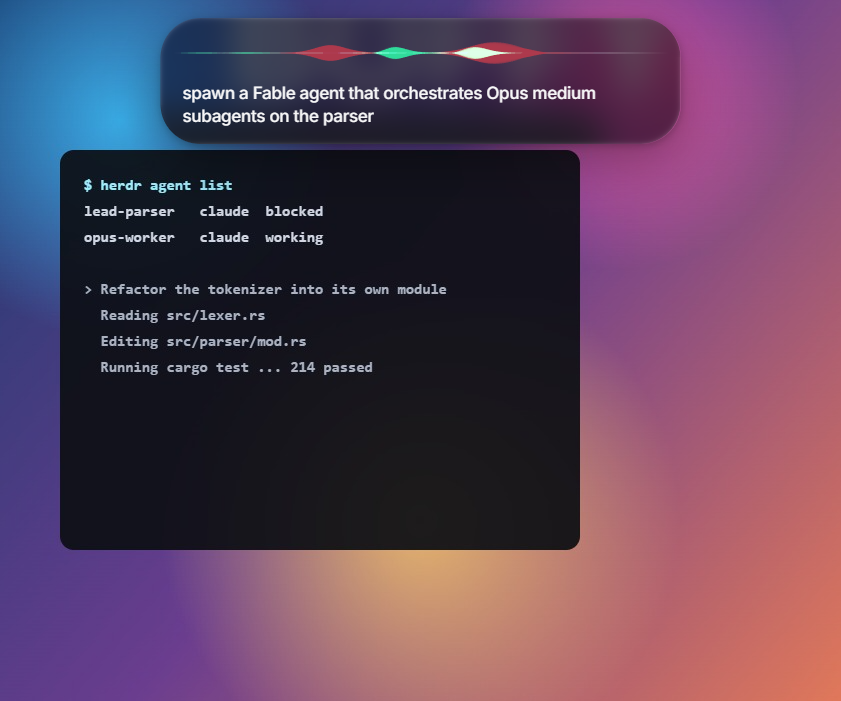
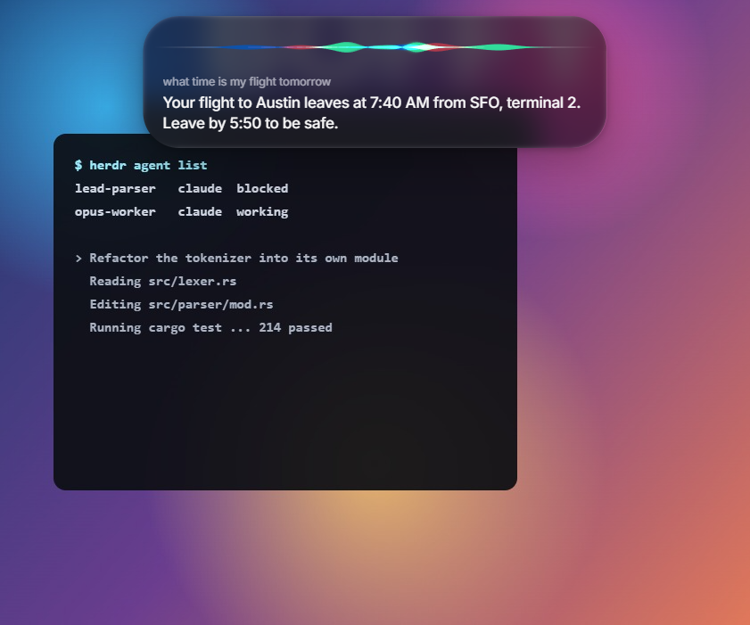
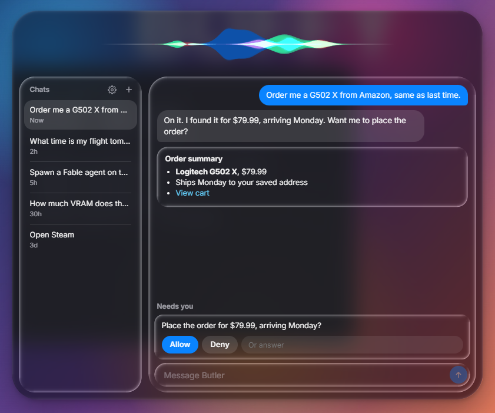
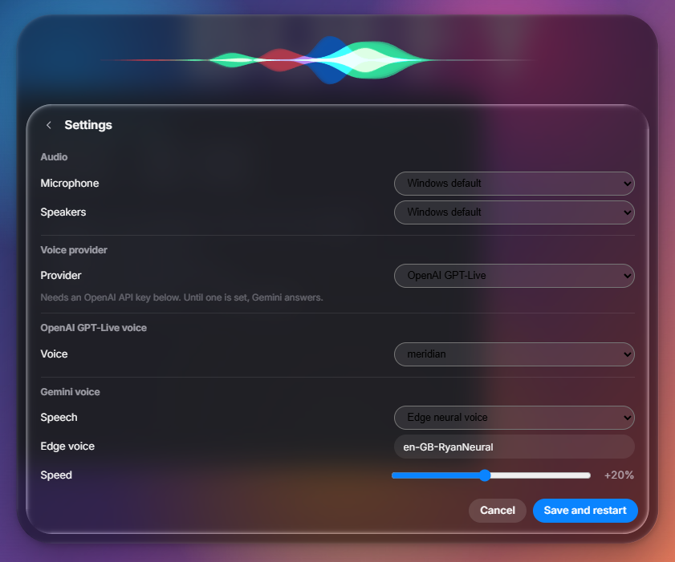

# Butler

A fast voice and desktop agent for Windows. Hold Pause and talk, or say "Butler". It
answers in a sentence, operates the PC, and runs Claude Code and Codex agents in herdr,
chiming when one of them actually needs you. It lives in a Dynamic Island at the top of
the screen, in liquid glass.

| Listening | Answering |
|---|---|
|  |  |
| **Panel** | **Settings** |
|  |  |

The screenshots are rendered from Butler's dev mode with sample data, not real chats.

## What it does

| You | Butler |
|---|---|
| Hold **Pause**, ask anything | Butler answers out loud in a British voice. With the panel closed, only a small pill with the Siri wave comes up at the top while it listens and answers. |
| Tap **Pause** | The island grows into the panel: past chats on the left (+ starts a new one, and so do three quiet hours; Butler remembers the whole current chat), the conversation and a text box on the right. Hold Pause to talk to it, like an intercom. Tap again or Esc to close. |
| Click the gear by **Chats** | Settings: microphone and speakers, the voice provider (OpenAI GPT-Live or Gemini) and each one's voice, API keys, and the talk key, which you record by pressing it. Saving restarts Butler. |
| Press **Pause** while Butler speaks | The speech stops. A tap does nothing more; tap again for the panel. Hold, then let go, and the panel and island go away too. |
| Nothing | While agents, tasks or routines are running, a small live-activity pill stays at the top. An agent that needs you turns it into an alert with a chime. |
| "Butler, open Steam" | Wake word with the command in the same breath. Follow-ups work without Pause until you go quiet. |
| "What's the weather in SF tomorrow" | Web search, spoken answer, sources in the dock. |
| "Sign me up for Mubi" / "order a G502 from Amazon" | A computer-use task on `gpt-6-astra` drives the screen. It asks before paying, sending, or accepting terms, by voice and in the dock. |
| "I'm AFK in this game, move the mouse every 30 seconds, give or take 10" | A routine: every 20 to 40 seconds a freshly generated, human-looking mouse gesture that ends where it started. "I'm back" stops it. |
| "Fix the flaky login test in my api repo" / "start a project that ..." | Opens a new herdr workspace on the vertical display, starts Claude on Opus 5.5 at high effort with fast mode off, and hands it the job. |
| "Spawn a Fable agent orchestrating Opus medium subagents to refactor the parser" | Same, on `claude --model claude-fable-5-1`, with orders to fan out to `opus-medium` workers. |
| "What's the lead agent doing?" / "tell it yes" | Reads the agent's screen, types into it, or presses keys for it. |
| "Model a brass pocket watch and give me renders" | Claude writes a Blender script, renders four views headless, iterates, and reports the PNG paths. |
| "Animate a jog cycle with the MOLE studio" | Claude runs the studio pipeline: skeleton preview first, painting only after you approve. |
| "What's this error?" / "read me that" / "which one should I pick?" | Butler looks: a screenshot of the screen or just the focused window goes straight into the voice conversation, so it answers from what you see. |
| "Click the blue Submit button" / "hold W for three seconds" / "drag that into the folder" | Manual override. Butler finds the thing on screen with the computer-use model (the best at pointing) and clicks, drags or scrolls there; the keyboard can type, press combos, or hold keys for games. |
| Open files, type text, press shortcuts, switch windows, volume, clipboard, PowerShell | Direct tools, well under a second. PowerShell that changes anything waits for your Yes. |

The chime rules: a herdr agent that turns **blocked** (approval or question on screen)
always rings the two-note bell and flashes the dock. An agent that just **finished** is
read by a small model first; you hear the bell only if its last message needs you,
otherwise a single soft tone.

## From your phone

`remote/` is a small private site you deploy to your own Vercel. The phone and Butler
both talk to it: you talk to Butler (hold the mic, or tap it to start and stop) or text
it, approve what is waiting, watch and steer agents, tap the same shortcuts as the dock, ask what
is on the screen, and take over the PC by hand: tap, double tap and long-press on a live
screenshot, a key row (Enter, Esc, Tab, copy, paste, Alt Tab), scrolling and typing.
Butler polls it once a second over outbound HTTPS, so nothing on the PC is exposed.
Phone text runs on the `remote` lane with the same tools as voice. Setup and security:
[remote/README.md](remote/README.md).

## Setup (Windows 11)

Needs Node 22+, AutoHotkey v2, and a Gemini API key (`GEMINI_API_KEY`, in `.env` or the
environment, or pasted into the settings page). An OpenAI key (`OPENAI_API_KEY`) adds the GPT-Live voice, the wake word and computer use; without one, Pause uses the turns engine. Claude Code, Codex CLI,
[herdr](https://github.com/JoshKappler/herdr-layout) on PATH, and Blender are needed only for the features that use them.

```powershell
git clone https://github.com/JoshKappler/butler
cd butler
powershell -ExecutionPolicy Bypass -File win\install.ps1
notepad $env:APPDATA\Butler\.env      # GEMINI_API_KEY=...
```

`install.ps1` runs `npm install`, creates `%APPDATA%\Butler\` (`.env`, `config.json`,
`state\`), adds Startup shortcuts for Butler and `butler-keys.ahk`, and starts both.
Re-running it is safe. Tray icon (cyan ring): click for the dock, right-click to restart
or quit.

**Before first use**

1. If another app already uses Pause, quit it or record a different talk key in settings.
   Two scripts cannot both own the key.
2. Optional, for an exact "needs you" signal from every Claude session, add the hook in
   the header of `win\hooks\butler-notify.ps1` to `~\.claude\settings.json`.

## How it works

```
 butler-keys.ahk (Pause) ─HTTP 127.0.0.1:47113─┐
 Claude hooks ───────────────────────────┤
                                          ▼
 ┌──────────────── Electron main (main.js) ────────────────┐
 │ tools ─ desktop (open, files, search, PowerShell gate)  │
 │       ─ computer.js   gpt-6-astra computer-use loop     │
 │       ─ routines.js   anti-AFK mouse, key taps, reminders│
 │       ─ agents/fleet  herdr panes + headless CLI runs    │
 │ wakewatch (gpt-live-transcribe) or Porcupine             │
 └───────┬──────────────────────────────┬──────────────────┘
         │ IPC                          │ JSON lines on stdin/stdout
 ┌───────▼────────────┐        ┌────────▼──────────────────────┐
 │ dock window         │        │ win/winhost.ps1 + ButlerHost.cs│
 │ WebRTC to            │        │ SendInput, screenshots,       │
 │ gpt-realtime-2.1     │        │ windows, Start menu apps      │
 └─────────────────────┘        └───────────────────────────────┘
```

**Voice engines.** `voice.engine` is `live` by default: OpenAI GPT-Live (`gpt-live-1`)
hears and speaks over WebRTC, and anything that needs Butler's tools it hands back as a
client delegation, which the `delegate` lane runs with the same tools as `turns`. The live
model speaks the result. A press buffers the mic from its first syllable while the session
connects, then catches up by skipping quiet frames; letting go sends silence, which is the
model's cue to answer. The session bills by the second, so it closes after
`voice.live.idleSeconds` of quiet, and the next press opens a fresh one seeded with the
current chat. Without an OpenAI key, `turns` answers instead.

`turns`: Pause records, and on release
the `hear` lane (a Gemini provider) transcribes the clip, and the `voice` lane answers that
transcript with the same tools, so the brain is any model in `providers`. The voice lane never
gets the audio, so it cannot rewrite the question to fit the screen. The answer
is spoken by Edge's neural voices (`voice.tts`, about half a second) with Windows SAPI as
the fallback. The last few exchanges ride along as context. `realtime` is OpenAI Realtime
over WebRTC, below.

**Why the Realtime engine is fast.** The Realtime session stays connected with no mic attached, so Pause
only swaps the mic track in (`replaceTrack`, no renegotiation). Turn detection is off in
push-to-talk, so releasing the key commits the turn at once instead of waiting for
silence. Each press refreshes the instructions with what is on screen (focused window,
agents, routines, open questions), so "what's this error" and "tell it yes" work without
explanation. After five quiet minutes the session reconnects fresh, which keeps context
and cost small. Slow work never blocks the voice: computer tasks and agents run in the
background and Butler speaks up when they land.

**The island** is one transparent window at the top of the screen. The island morphs
inside it on Apple's spring curves, clicks pass through everywhere but the glass, and the
window hides completely when the island is gone, so it never sits over a fullscreen game.
The glass (`renderer/glass.js`) is a WebGL2 port of the Metal shader in
[BarredEwe/LiquidGlass](https://github.com/BarredEwe/LiquidGlass): a blurred, saturated
view of what is behind it, pulled inward at the rim like a lens, with a thin rim light.
No web page can see the desktop behind its own window, so Butler screenshots that region
when the island opens and the glass bends that. The boxes in the panel are glass too and
bend the island under them. The rim light leans slowly toward the pointer, at most 30 degrees, and sweeps around once when
the island changes shape. The wave is [siriwave](https://github.com/kopiro/siriwave),
driven by the mic level while you talk and by Butler's voice while it answers. Type is Inter.

**Live captions** stream your words while you hold Pause. With `META_API_KEY` set they
come from Meta's Muse Voice Transcribe (partials every 80 ms, first on the streaming
accuracy leaderboard, $0.18 an hour); otherwise from OpenAI `gpt-live-transcribe`.
`captions.engine` picks one explicitly or turns them off.

**Model lanes.** Every side job names a lane (`fast` for the "needs you?" check, `files`
for the file-search subagent, `search`, `computer`), and `config.lanes` maps each to a
provider and model. Providers speak the OpenAI Responses API, Gemini's own
generateContent, the OpenAI-compatible chat API, or Anthropic's Messages API, which covers
OpenAI, Google, Meta (Muse Spark) and Anthropic, so trying a model is one line:
`"files": { "provider": "meta", "model": "muse-spark-1.3", "params": { "reasoning_effort": "minimal" } }`.
`node scripts/bench-lanes.js` times every candidate you have a key for on a one-line
answer and a small tool-using file search, so the choice rests on your own numbers. Web
search needs a Responses or Gemini provider (Gemini grounds on Google Search); computer
use needs a Responses provider.

**Seeing and manual control.** `look` captures the screen or the focused window
(`src/screen.js`) and the voice session receives it as an image, so there is no second
model in the loop. The phone's text agent cannot take images mid-loop, so it gets a
description from the `vision` lane instead (Gemini by default; Claude through the
official Anthropic SDK with `{ "provider": "anthropic", "model": "claude-opus-5" }`).
`mouse` with a description ("the Submit button") asks gpt-6-astra for a single pointing
action on a fresh screenshot and clicks there; with x/y it uses pixels of the last look.
A description it cannot find is an error, never a guess.

**The wake word** costs nothing in a quiet room. The mic is gated by level in the dock,
and only speech (plus half a second of pre-roll) streams to a transcription-only
Realtime session biased toward "Butler". Set `wake.engine` to `porcupine` for a fully
local detector: train "Butler" in Picovoice Console, download the Windows `.ppn`, and
set `PICOVOICE_ACCESS_KEY` and `wake.porcupineKeywordPath`. `"none"` turns it off.

**Computer use** is the OpenAI Responses `computer` tool on `gpt-6-astra`, executed by
`winhost` with real `SendInput` events on the primary monitor. Screenshots are
downscaled to 1600px and coordinates are mapped back. The dock sets content protection,
so it never appears in the agent's screenshots. Safety checks from the API and the
agent's own `ask_josh` questions both land in "Waiting on you".

**Agents.** Visible agents get a tab in a `butler` workspace in herdr (session
`herdr.session`; empty means herdr's default) via `herdr agent start`, and prompts go in
with `herdr agent prompt`, which pastes and presses Enter atomically. Butler polls
`herdr agent list` every two seconds; herdr's screen detection supplies the
idle/working/blocked/done states. Headless agents (`visible: false`) run
`claude -p --output-format stream-json` or `codex exec`, take the prompt on stdin, and
report their result by voice.

## Configuration

Defaults live in `config.default.json`. Override any key in
`%APPDATA%\Butler\config.json`; only the keys you set change. Common ones:

| Key | Default | Notes |
|---|---|---|
| `voice.engine` | `live` | `turns` for any model lane plus Edge speech, `realtime` for OpenAI Realtime. |
| `voice.live` | `gpt-live-1`, voice `meridian`, closes after 30 s quiet | Live engine only. Any GPT-Live voice. |
| `voice.tts` | Edge, `en-GB-RyanNeural` at `+20%` | Turns engine only. `rate` is the speaking speed. `"engine": "sapi"` stays offline. |
| `voice.model` | `gpt-realtime-2.1` | Realtime engine only. `gpt-realtime-2.1-mini` is much cheaper and still calls tools. |
| `voice.voice` | `cedar` | Realtime engine only. Any Realtime voice. |
| `voice.reasoningEffort` | `low` | Realtime engine only. `minimal` answers faster. |
| `lanes.*` | `gemini-3.8-flash` everywhere but computer (`gpt-6-astra`) | Any lane can point at any provider in `providers`. |
| `captions.engine` | `auto` | `muse`, `openai` or `off`. |
| `dock.liveActivities` | `true` | The live-activity pill while work is running. |
| `audio.input`, `audio.output` | empty | Device names as Windows shows them; empty is the Windows default. The settings page sets them. |
| `hotkeys.key` | `Pause` | The talk key, as an AutoHotkey key name. The settings page records it. |
| `hotkeys.tapMs` | 350 | Tap versus hold. The wave pill waits this long, so a tap never flashes it. |
| `paths.projects` | `~/projects` | Default working folder for agents. |
| `paths.blender` | `blender` | Full path to `blender.exe` if it is not on PATH. |
| `agents.models` | fable, opus, sonnet, haiku, astra, sol, luna | Spoken name to model id. `default` (Opus 5.5) is used when none is named. |
| `agents.claude` | effort `high`, fast mode off | Claude's reasoning effort and extra arguments for every agent it starts. |
| `agents.announce` | `chime` | `voice` also speaks when a visible agent needs you. |
| `search.everything` | empty | Path to voidtools `es.exe` for instant file search. |
| `shortcuts` | `{}` | `"notes": {"target": "C:\\...\\notes.md"}` makes "open notes" exact. |
| `herdr.monitor` | `side` | Where the herdr button puts herdr's window: `side` fills the first display that is not the main one, `primary` the main one, empty leaves it alone. |
| `herdr.launch` | `wt.exe herdr` | How Butler starts herdr when it is not running. |
| `persona` | a quick, dry assistant | The voice's personality, as a prompt. |
| `dock.quickActions` | herdr, New Claude, New Codex | The phone's shortcut buttons: any tool plus args. New Claude and New Codex open the agent in its own herdr workspace. |

## Development

```bash
npm install
npm test                                   # no Windows needed
BUTLER_SHOT=out.png BUTLER_SHOT_STATE=panel npx electron .   # also settings, listening, speaking, alert, live
```

`win/ButlerHost.cs` compiles under C# 5, the language level Windows PowerShell's
`Add-Type` uses; `mcs -langversion:5 -target:library -r:System.Drawing.dll
-r:System.Windows.Forms.dll win/ButlerHost.cs` checks it anywhere. Logs go to
`%APPDATA%\Butler\state\butler.log`.

## Status

Butler is my daily assistant on Windows 11. It's built around my own setup (herdr,
Claude Code, an AutoHotkey talk key), so expect some rough edges on other machines.

## License

MIT, see [LICENSE](LICENSE). Third-party code in the dock: the glass shader is ported
from [BarredEwe/LiquidGlass](https://github.com/BarredEwe/LiquidGlass) (MIT), the gear
icon is from [Feather](https://github.com/feathericons/feather) (MIT), and siriwave (MIT)
and Inter (OFL) come from npm.
